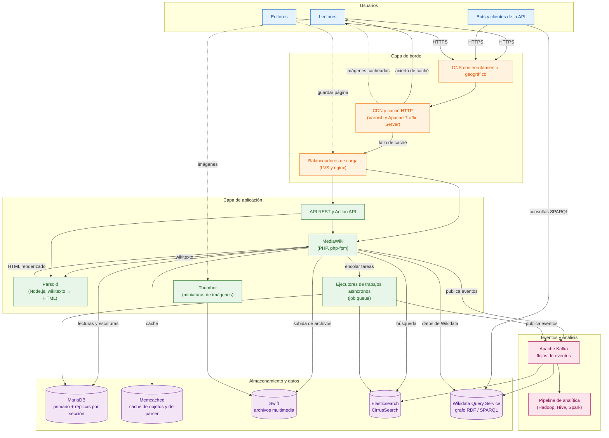

# Arquitectura de Wikipedia (diagrama Mermaid)

Diagrama simplificado de la infraestructura de Wikipedia, operada por la Fundación Wikimedia. Los servicios y nombres concretos cambian con el tiempo, así que debe tomarse como una vista aproximada.

## Componentes principales

- **Borde (CDN):** las peticiones de lectura se sirven desde cachés HTTP cercanas al usuario; solo los fallos llegan al origen.
- **MediaWiki:** software PHP que genera las páginas, gestiona la edición, los usuarios y los permisos.
- **Parsoid:** convierte entre wikitexto y HTML para el editor visual y la API.
- **Bases de datos:** MariaDB en configuración primario/réplicas, con caché de objetos en Memcached.
- **Medios:** archivos originales en Swift; las miniaturas se generan bajo demanda con Thumbor.
- **Búsqueda:** Elasticsearch mediante CirrusSearch.
- **Wikidata:** servicio de consultas SPARQL sobre datos RDF.
- **Eventos y análisis:** Kafka distribuye los eventos a búsqueda, Wikidata y al pipeline de analítica.
