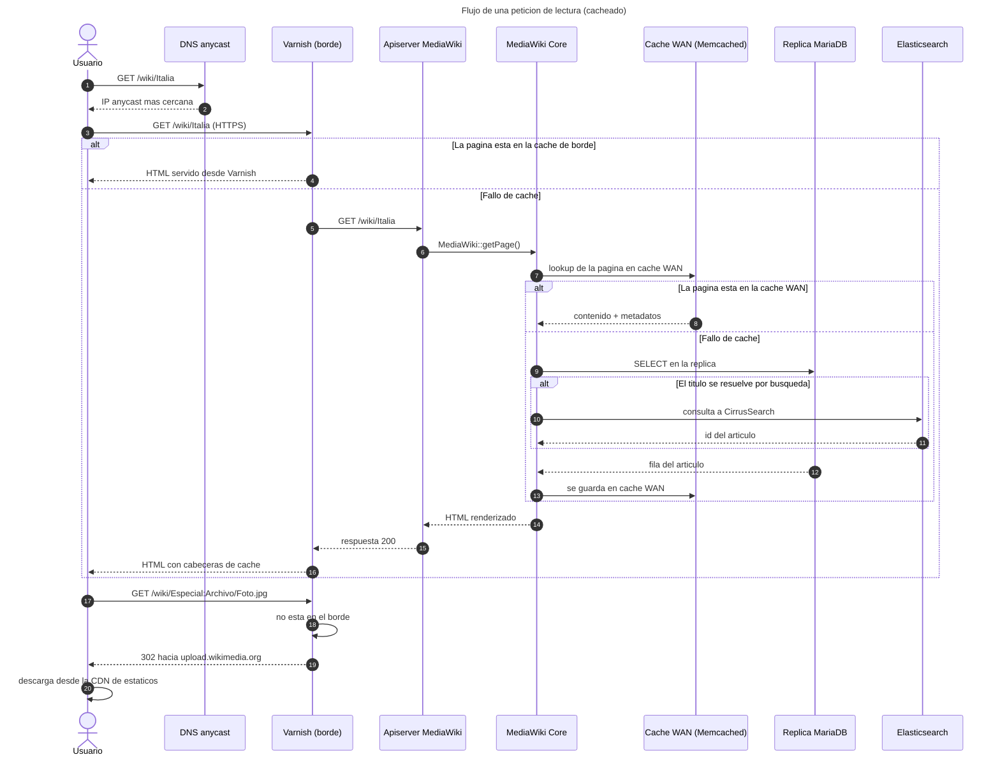
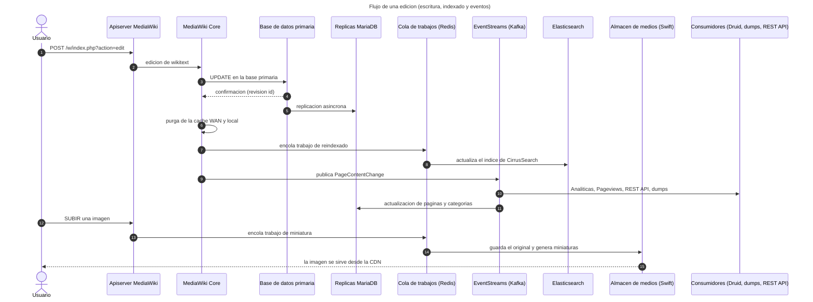

# Arquitectura de Wikipedia

Documento en español con la arquitectura de producción de Wikipedia (Wikimedia Foundation), representada
con diagramas **Mermaid**.

## Archivos generados

| Archivo | Contenido |
|---|---|
| `wikipedia-arquitectura.mmd` / `.svg` / `.png` | Diagrama general por capas (el principal) |
| `wikipedia-datacenters.mmd` / `.svg` / `.png` | Reparto geográfico de centros de datos y anycast |
| `wikipedia-flujo-lectura.mmd` / `.svg` / `.png` | Secuencia de una petición de lectura (cacheada) |
| `wikipedia-flujo-escritura.mmd` / `.svg` / `.png` | Secuencia de una edición (escritura, indexado y eventos) |

Para regenerar los `.svg`/`.png`: `mmdc -i archivo.mmd -o archivo.svg`

---

## 1. Diagrama general de la arquitectura

```mermaid
---
title: Arquitectura de Wikipedia (producción)
---
flowchart TB

  subgraph CLIENTES["1. Clientes"]
    direction LR
    NAV["Navegador<br/>web, movil, escritorio"]
    BOT["Bots, raspadores<br/>y lectores de RSS"]
    API["Aplicaciones de terceros<br/>consumidores de API"]
    DUMP["Consumidores de dumps<br/>dumps.wikimedia.org"]
  end

  subgraph BORDE["2. Capa de borde: red anycast, CDN y gateway"]
    direction LR
    DNS["DNS anycast<br/>wikipedia.org"]
    ANY["IP anycast<br/>edge de Wikimedia"]
    VARN["Caches de borde Varnish<br/>HTML cacheado"]
    CDN["CDN de estaticos<br/>upload.wikimedia.org"]
    GW["Wikimedia API Gateway<br/>REST + TLS"]
  end

  subgraph FRONT["3. Servidores frontend (apiserver)"]
    direction LR
    ACTION["Action API<br/>api.php"]
    REST["REST API<br/>rest.php"]
  end

  subgraph CORE["4. MediaWiki Core (servidores de aplicacion PHP)"]
    direction LR
    PARSER["Parser wikitext / HTML<br/>plantillas, referencias"]
    EDIT["Edicion, permisos<br/>y cuentas de usuario"]
    MW["Logica de wiki<br/>paginacion, historial, vista"]
    JOBS["Planificador de trabajos<br/>mantenimiento de indices"]
  end

  subgraph AUX["5. Servicios auxiliares"]
    direction LR
    PARSOID["Parsoid<br/>wikitext a HTML (VisualEditor)"]
    WBASE["Wikidata / Wikibase<br/>y su servicio de consultas"]
    CIRRUS["Busqueda<br/>CirrusSearch"]
    CTRANS["ContentTranslation<br/>y otras herramientas"]
    PAGEV["Pageviews API<br/>y metricas de trafico"]
    DUMPGEN["Generador de dumps<br/>y Wikimedias Enterprise"]
  end

  subgraph CACHE["6. Capas de cache"]
    direction LR
    LOCAL["Cache local de paginas<br/>APCu en cada servidor"]
    WAN["Cache WAN de objetos<br/>Memcached por centro de datos"]
    REDIS["Cola de trabajos<br/>Redis"]
  end

  subgraph DATOS["7. Capa de datos y almacenamiento"]
    direction LR
    PRIM["Base de datos primaria<br/>MariaDB"]
    REPL["Replicas de base de datos<br/>MariaDB en solo lectura"]
    ES["Elasticsearch<br/>indice de busqueda"]
    RESTBASE["Almacenamiento REST<br/>RESTBase / Wikidata REST"]
    SWIFT["Almacen de medios<br/>Swift + miniaturas"]
    KAFKA["EventStreams<br/>Kafka"]
    LAKE["Data lake HDFS<br/>y almacenamiento analitico Druid"]
  end

  subgraph PLAT["8. Plataforma compartida"]
    direction LR
    K8S["Kubernetes<br/>contenedores y autoscaling"]
    PUPPET["Puppet y Git<br/>gestioned de configuracion"]
    OBS["Prometheus y Grafana<br/>monitorizacion"]
    LOGS["Logging centralizado<br/>rsyslog y Loki"]
  end

  DNS --> ANY
  ANY --> VARN
  ANY --> GW
  VARN -->|"peticion con cache"| NAV
  VARN -->|"fallo de cache"| FRONT
  CDN -->|"imagenes, CSS, JS"| NAV
  CDN -->|"miniatura bajo demanda"| SWIFT

  FRONT --> CORE
  GW -->|"enruta a la REST API"| REST
  GW -->|"consultas de trafico"| PAGEV

  MW <--> PARSER
  MW <--> EDIT
  MW --> JOBS
  MW <--> PARSOID
  MW <--> WBASE
  MW <--> CIRRUS
  MW <--> CTRANS
  CIRRUS --> ES
  WBASE --> REPL
  PAGEV --> KAFKA

  MW -->|"lectura"| LOCAL
  LOCAL -->|"fallo de cache"| WAN
  WAN -->|"fallo de cache"| REPL
  MW -->|"escritura"| PRIM
  PRIM -->|"replicacion"| REPL
  MW -->|"encola trabajo"| REDIS
  REDIS -->|"workers"| JOBS
  JOBS -->|"genera miniaturas"| SWIFT
  JOBS -->|"reindexado"| ES
  MW -->|"publica cambios"| KAFKA
  KAFKA --> RESTBASE
  KAFKA --> PAGEV
  KAFKA --> LAKE
  LAKE -->|"publica dumps"| DUMP
  DUMPGEN --> LAKE
  SWIFT -->|"lectura de ficheros"| MW

  PLAT -.->|"soporte de toda la plataforma"| CORE

  classDef cliente fill:#eef2f7,stroke:#4a6fa5,color:#12233b
  classDef borde fill:#e7f4ea,stroke:#2e7d32,color:#123d18
  classDef front fill:#fff4e5,stroke:#b26a00,color:#4a2e00
  classDef core fill:#fdecea,stroke:#c0392b,color:#4a1310
  classDef aux fill:#f3e8fd,stroke:#7d3c98,color:#33184a
  classDef cache fill:#e6f2ff,stroke:#1f6fb2,color:#0b2f4d
  classDef datos fill:#fff9db,stroke:#a98b00,color:#443600
  classDef plat fill:#f2f2f2,stroke:#8a8a8a,color:#333333

  class NAV,BOT,API,DUMP cliente
  class DNS,ANY,VARN,CDN,GW borde
  class ACTION,REST front
  class PARSER,EDIT,MW,JOBS core
  class PARSOID,WBASE,CIRRUS,CTRANS,PAGEV,DUMPGEN aux
  class LOCAL,WAN,REDIS cache
  class PRIM,REPL,ES,RESTBASE,SWIFT,KAFKA,LAKE datos
  class K8S,PUPPET,OBS,LOGS plat
```

### Lectura del diagrama por capas

1. **Clientes** — navegadores, apps móviles y de escritorio, bots (respetando `robots.txt`), aplicaciones que
   consumen las APIs públicas y personas que descargan los *dumps* completos.
2. **Capa de borde** — todo el tráfico entra por **IP anycast** gestionada por Wikimedia (con RIPE NCC como
   patrocinador del espacio de direcciones). Un **DNS anycast** devuelve la IP más cercana. Sobre esa IP hay
   cachés **Varnish** (el HTML público, los 404 y la API de lectura) y, aparte, la **CDN de estáticos**
   (`upload.wikimedia.org`, servida por Fastly) para imágenes, miniaturas, CSS y JS. El **Wikimedia API Gateway**
   termina TLS y enruta el tráfico de las APIs REST con autenticación OAuth 2.0 y CORS.
3. **Servidores frontend (apiserver)** — servidores de entrada que exponen la **Action API** (`api.php`) y la
   **REST API** (`rest.php`).
4. **MediaWiki Core** — la aplicación PHP-FPM: parser de wikitext y plantillas, edición, permisos, historial,
   paginación, planificador de trabajos y generación de miniaturas.
5. **Servicios auxiliares** — **Parsoid** (convierte wikitext ↔ HTML/RDF y alimenta al VisualEditor),
   **Wikidata/Wikibase** y su *Query Service*, **CirrusSearch** (búsqueda sobre Elasticsearch), **ContentTranslation**,
   **Pageviews** y los generadores de *dumps* / Wikimedia Enterprise.
6. **Cachés** — caché local de páginas con APCu en cada servidor de aplicación, **caché WAN de objetos**
   (Memcached) compartida por centro de datos para el HTML renderizado, y Redis como cola de trabajos.
7. **Datos y almacenamiento** — MariaDB primaria (escrituras) con réplicas de solo lectura, Elasticsearch para
   el índice de búsqueda, almacenamiento REST (RESTBase y Wikidata REST), **Swift** para el almacén de medios y
   miniaturas, **EventStreams (Kafka)** como bus de eventos y el *data lake* HDFS con **Druid** para analítica.
8. **Plataforma compartida** — Kubernetes para contenedores y autoscaling, Puppet + Git para gestión de
   configuración, Prometheus/Grafana para monitorización y logging centralizado.

---

## 2. Reparto geográfico: anycast y centros de datos

```mermaid
---
title: Reparto geografico de los centros de datos de Wikimedia
---
flowchart LR
  USER["Usuarios de todo el mundo"]

  subgraph ANYCAST["DNS e IP anycast (gestionado por RIPE NCC)"]
    POPS["Puntos de presencia anycast<br/>se enruta al centro de datos mas cercano"]
  end

  subgraph PRIM["Centros de datos primarios: aplicacion y base de datos"]
    EQIAD["eqiad<br/>Ashburn, EE. UU.<br/>MediaWiki, MariaDB, busqueda"]
    CODFW["codfw<br/>Carrollton (Dallas), EE. UU.<br/>MediaWiki, MariaDB, busqueda"]
  end

  subgraph STOR["Centros de datos de almacenamiento y datos masivos"]
    ESAMS["esams<br/>Amsterdam, Paises Bajos<br/>Swift, data lake, Druid, EventStreams"]
    DRUID["druid<br/>Chicago, EE. UU.<br/>Swift, data lake, Druid, EventStreams"]
  end

  subgraph SEC["Centros secundarios o de solo lectura"]
    EQSIN["eqsin<br/>Singapur"]
    UYORD["uyord<br/>Montevideo, Uruguay"]
    ORD["Centros *ord (Ashburn, Dallas)<br/>replicas y servicios de lectura"]
  end

  subgraph NET["Red y transporte"]
    IX["Interconexion entre centros<br/>y con proveedores de nube"]
    TRS["Transito y peering<br/>caching en redes externas"]
  end

  USER --> ANYCAST
  ANYCAST --> POPS
  POPS --> PRIM
  POPS --> STOR
  POPS --> SEC
  PRIM <--> STOR
  PRIM <--> SEC
  STOR <--> SEC
  PRIM <--> NET
  STOR <--> NET
  SEC <--> NET
  NET --> TRS
  TRS --> USER

  classDef usr fill:#eef2f7,stroke:#4a6fa5,color:#12233b
  classDef prim fill:#fdecea,stroke:#c0392b,color:#4a1310
  classDef stor fill:#fff9db,stroke:#a98b00,color:#443600
  classDef sec fill:#e7f4ea,stroke:#2e7d32,color:#123d18
  classDef net fill:#f3e8fd,stroke:#7d3c98,color:#33184a

  class USER usr
  class EQIAD,CODFW prim
  class ESAMS,DRUID stor
  class EQSIN,UYORD,ORD sec
  class IX,TRS net
```

- **Anycast**: una única IP (asignada por cortesía de RIPE NCC) se anuncia desde muchos puntos de presencia,
  de modo que el usuario siempre habla con el centro de datos más cercano por latencia.
- **Primarios** (`eqiad`, `codfw`): ejecutan MediaWiki, la base de datos primaria y las réplicas de lectura.
- **Almacenamiento y datos masivos** (`esams`, `druid`): Swift (medios y miniaturas), *data lake* HDFS, Druid y
  EventStreams.
- **Secundarios** (`eqsin`, `uyord`, centros `*ord`): réplicas y servicios de solo lectura para descargar carga
  de los primarios y acercar el contenido a Asia y Sudamérica.
- **Red**: interconexión dedicada entre centros (peering en puntos neutros, enlaces de tránsito) que permite
  replicar bases de datos y mover el *data lake*.

---

## 3. Flujo de una petición de lectura

Puntos clave: la **caché de borde** absorbe la mayoría del tráfico; si falla, la **caché WAN** evita llegar a la
base de datos; solo las escrituras tocan la primaria y la lectura se reparte entre **réplicas**; los ficheros
binarios nunca pasan por MediaWiki (se redirigen a la CDN).

---

## 4. Flujo de una edición (escritura, indexado y eventos)

Puntos clave: las escrituras son **síncronas contra la primaria** y se propagan después a las réplicas; el
mantenimiento pesado (reindexado, miniaturas, tablas, feeds) se **desacopla en una cola de trabajos**; cada
cambio se publica en **EventStreams** como evento, lo que permite que analítica, API REST, dumps y el
front-end de novedades se actualicen sin tocar la ruta de escritura.

---

## 5. Notas de simplificación

- Se omiten los servicios de **autenticación** (OAuth 2.0 + central de identidad), **ABUSE** (filtros),
  **Event Platform** y los **Pontoon / Phabricator / Gerrit** de desarrollo.
- La separación entre «frontend» y «backend» de MediaWiki es una simplificación: los `apiserver` son proxies
  inversos que despachan a los `appserver` (aquí agrupados en la capa MediaWiki Core).
- Wikimedia opera también en la nube (Wikimedia Cloud, Wikimedia Enterprise y servicios para proveedores de
  navegadores), no representados en el diagrama.
